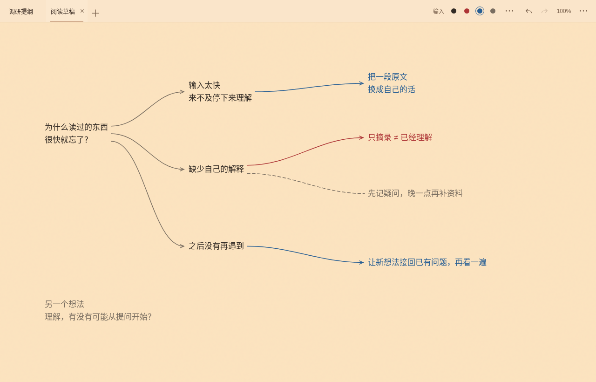
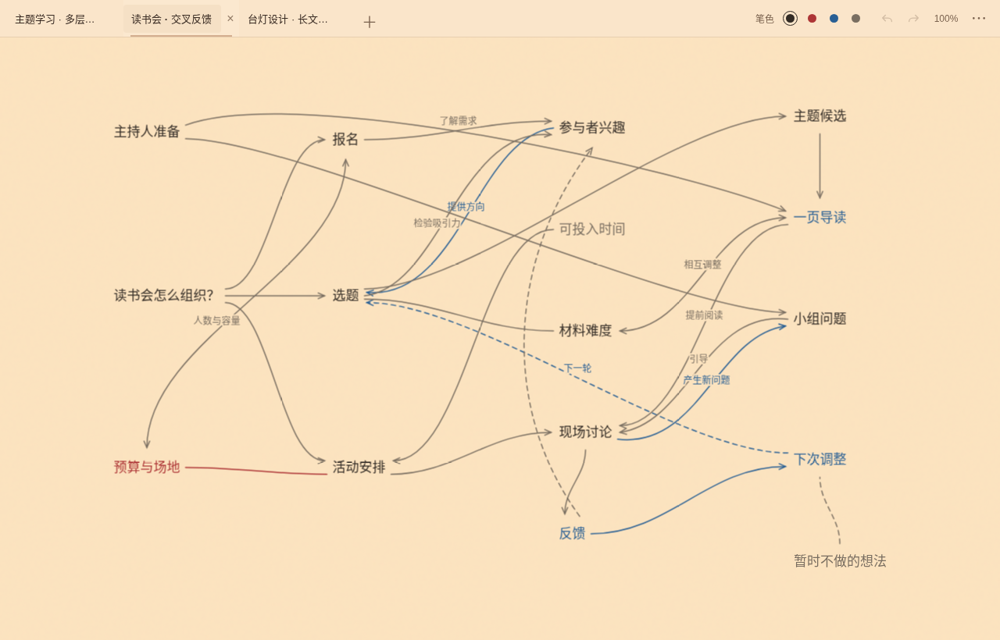

# v0.3 · 编辑体验验证

日期：2026-11-25。基于 `16c4726`（文字避让连线）继续修改。

## 这次解决的实际问题

旧版 Tab 只在 textarea 输入状态生效，选中已有文字块后会变成浏览器焦点导航；中文组合输入结束后的统一保护窗口也会吞掉紧接着的 Tab。原先的撤销只覆盖部分结束编辑动作，没有重做；颜色只作用于整块文字。保存、视野和文件操作围绕单份草稿组织。

这次统一了文字和结构编辑历史，补上可连续深入的子块与同级关系、局部四色文本、工作区标签和后台保存。触控板保留两轴增量，按帧合并平移，按滚动单位归一化；鼠标中键、空白拖移、编辑中 Alt 拖块使用同一坐标系。

## 已验证

使用 Node.js 内置测试运行器及真实 Chromium 158（Linux）。共 **33 项自动化检查通过，0 失败**。

| 范围 | 项数 | 覆盖的行为 |
| --- | ---: | --- |
| 工作区保存 | 11 | v1 迁移但不覆盖旧键、快速切页隔离、关闭后恢复、刷新、损坏数据保护、保存失败重试、持续输入时定期保存 |
| 文本编辑 | 8 | 四色片段归一、选区着色、下一笔切色、换行、emoji 删除、纯文本粘贴、真实 Chromium 中文组合输入及颜色定位 |
| 编辑流程 | 11 | 三级 Tab、同级 Enter、已有块继续分支、F17/F18 原始虚拟按键、结构撤销/重做、标签命名与恢复、双轴滚动、缩放锚点、无框输入 |
| 编辑连续性 | 3 | 换笔色后独立撤销、鼠标切页恢复反向选区和焦点、撤销 Alt 拖动恢复位置和光标 |

运行环境已有 Playwright 时，可执行：

```sh
BROWSER_EXECUTABLE=/path/to/chromium PAPER_BROWSER=/path/to/chromium node --test tests/workspace.test.cjs tests/editor.unit.test.cjs tests/editor-flows.cjs tests/editor-continuity.cjs
```

测试也支持从 `CODEX_PRIMARY_RUNTIME_NODE_MODULES` 读取工作环境提供的 Playwright；应用本身没有新增运行依赖。

另检查了 1280×820 与 Windows 最小窗口 580×475 下的布局。下图来自真实运行的编辑页面，使用独立示例内容；没有放入私人原始手稿。



## 走线的追加优化

用户允许一定的线字交叠，并指出旧版方形绕行不自然。新版本使用简洁曲线，综合考虑长度、弧度、文字和线线交叉；不把完全避字设为硬性条件。短间距收紧弧度，多条关系略微分散端点，反向关系分开成弧，说明文字尽量错开。细微纸色文字描边保持偶尔交叠处的可读性，不添加文本框。

通过实际页面检查三组虚构草稿：多层分支 15 节点/14 线、交叉关系 16 节点/24 线、长段文字 13 节点/21 线。所有原始文字坐标、关系端点、线型、方向、颜色和说明均保持不变，页面无运行错误。另以 50 节点/100 线检查自然曲线与缓存刷新，没有要求零交叠。



复现三组截图：

```sh
BROWSER_EXECUTABLE=/path/to/chromium node tests/routing-preview.cjs --out artifacts/routing-preview
```

## Windows 包

版本 0.3.0；固定的 Electron 45.5.0 x64 运行时经过官方 SHA-256 校验。最终 ZIP 完整性通过，包内六个 dist 文件与四个桌面运行文件均与定稿源码逐字节一致。

F17/F18 由桌面宿主转发一次，浏览器与桌面使用同一颜色动作；不额外占用 F19/F20。Windows 包没有改变旧版应用数据目录，首次启动会读取已有单草稿数据。

## 验证边界

本轮未在用户的实体 Windows 电脑上启动新版，因此具体触控板的惯性、原生输入法候选窗与本地按键映射仍需在该设备体验。自动化的组合输入和滚动事件检查不能替代真实硬件手感。

撤销/重做属于当前运行会话，各标签独立；它不是跨重启的完整版本历史。正常内容、关系、标签及视野会本地保存。AI 分析、云同步、纸笔导入、数学专用输入及多对象框选尚未在本轮加入。
